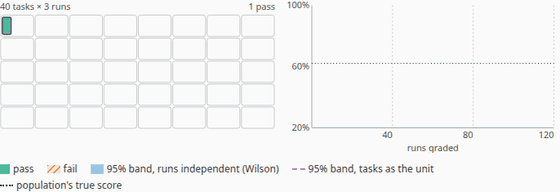
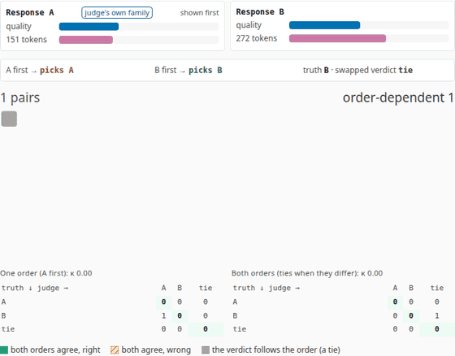
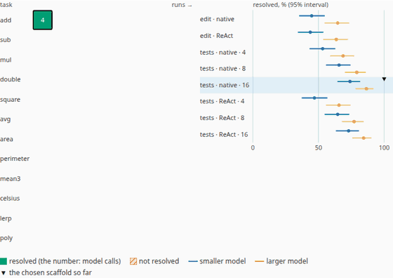
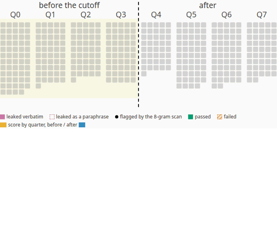

# Agent Evals Explained

**Live:** https://agent-evals-explained.vercel.app

How to tell whether an agent is good, and how sure you can be. Chapter 1 takes an eval apart (tasks, runs, a grader,
a score) and shows why the error bar shrinks more slowly than it seems once tasks, not runs, are the unit. Chapter 2
describes the benchmarks agents are quoted on from their papers (SWE-bench and Verified, τ-bench, GAIA, WebArena,
OSWorld, Terminal-Bench) and animates one SWE-bench-style task, issue to patch to hidden tests. Chapter 3 derives the
unbiased **pass@k** and **pass^k** estimators and shows them pull apart. Chapter 4 reruns a benchmark to show which
intervals (Wald, Wilson, exact, bootstrap) keep their promise, why a few tenths of a point is a tie, and how many tasks
a question needs. Chapter 5 compares two agents on the same tasks: paired differences, McNemar's test, and the
variance from tasks against the variance from runs. Chapter 6 turns to the grader: a simulated LLM judge with
position, length and self-preference biases, the swap test, Cohen's κ, and correcting a lenient pass/fail judge.
Chapter 7 grades whole trajectories (waste, unsafe actions, verification, false claims), including runs recorded from
a small open-weights model. Chapter 8 runs one simulated model through the engine's harness under sixteen
configurations and measures how far the harness alone moves the score. Chapter 9 leaks benchmark tasks and shows what
n-gram overlap, canary strings and a time split each see. Chapter 10 puts every configuration on the cost–success
plane: the Pareto front and dollars per solved task.

Each chapter is built around an animation, with the maths beside the picture, driven by
[Agent_Loop_Sim](https://github.com/BrendanJamesLynskey/Agent_Loop_Sim)'s **evals** module (engine 1.9.0),
identically in Python and in the browser: a synthetic benchmark under a two-parameter item-response model, the
standard estimators (each tested against scipy and statsmodels in the engine's CI), a simulated judge, a trajectory
grader, a stochastic model run through the engine's real harness, and a contamination model. No language model runs on
the site or in CI.

|                                                                                                                                                                              |                                                                                                                               |
| ---------------------------------------------------------------------------------------------------------------------------------------------------------------------------- | ----------------------------------------------------------------------------------------------------------------------------- |
|                           |                   |
|  |  |

Every chapter's animation is in [`docs/media`](docs/media) as a GIF and a WebM (`pnpm animations`).

Part of a family of companion sites, in four tracks (Foundations, Hardware, Inference, Agents); every header shows
where you are as "Track › Site". Agents: [Agent Harnesses Explained](https://agent-harnesses-explained.vercel.app),
[Agent Protocols Explained](https://agent-protocols-explained.vercel.app),
[Agent Context Explained](https://agent-context-explained.vercel.app),
[Agent Orchestration Explained](https://agent-orchestration-explained.vercel.app), this one (Evals) and
[Agent Security Explained](https://agent-security-explained.vercel.app). Foundations:
[Decoder](https://transformer-decoder-explained.vercel.app) and
[Training](https://transformer-training-explained.vercel.app). Hardware:
[GPU Kernels Explained](https://gpu-kernels-explained.vercel.app),
[Systolic Arrays Explained](https://systolic-arrays-explained.vercel.app) and
[AI Racks Explained](https://ai-racks-explained.vercel.app). Inference:
[LLM Inference Explained](https://llm-inference-explained.vercel.app),
[LLM Architectures Explained](https://llm-architectures-explained.vercel.app),
[Numerics Explained](https://numerics-explained.vercel.app),
[Inference Trade-offs Explained](https://inference-tradeoffs-explained.vercel.app).

## Chapters

| #   | Chapter                                                                                            | The animation                                                                                                                                                       |
| --- | -------------------------------------------------------------------------------------------------- | ------------------------------------------------------------------------------------------------------------------------------------------------------------------- |
| 1   | [What an eval is](https://agent-evals-explained.vercel.app/learn/01-what-an-eval-is)               | 40 tasks × 3 runs graded one at a time; the score with a band counting runs (Wilson) and one counting tasks (cluster-robust)                                        |
| 2   | [The benchmarks](https://agent-evals-explained.vercel.app/learn/02-the-benchmarks)                 | One SWE-bench-style task: issue, the agent's steps, its patch, hidden FAIL_TO_PASS and PASS_TO_PASS tests, the verdict; three patches                               |
| 3   | [pass@k and pass^k](https://agent-evals-explained.vercel.app/learn/03-pass-at-k-and-pass-hat-k)    | 30 tasks × 10 samples; each task's unbiased pass@k and pass^k as k grows, against the true curves                                                                   |
| 4   | [Uncertainty](https://agent-evals-explained.vercel.app/learn/04-uncertainty)                       | The benchmark rerun 30 times: each rerun's interval against the truth, and every method's coverage; exact coverage; a calculator                                    |
| 5   | [Comparing two agents](https://agent-evals-explained.vercel.app/learn/05-comparing-two-agents)     | Two agents on 300 shared tasks: discordant tasks, paired against unpaired intervals, the variance from tasks and from runs                                          |
| 6   | [Graders](https://agent-evals-explained.vercel.app/learn/06-graders)                               | 200 pairs judged in both orders by a judge with chosen biases: order-dependent verdicts, agreement tables and κ; a pass/fail judge corrected with a calibration set |
| 7   | [Trajectories, not just outcomes](https://agent-evals-explained.vercel.app/learn/07-trajectories)  | A trajectory event by event with the grader's flags and tallies, then three verdicts; scripted runs and three recorded Qwen2.5-1.5B runs                            |
| 8   | [The harness is part of the result](https://agent-evals-explained.vercel.app/learn/08-the-harness) | 12 tasks × 8 runs through the engine's harness under one of 16 configurations; every configuration's rate and interval for both models                              |
| 9   | [Contamination and leakage](https://agent-evals-explained.vercel.app/learn/09-contamination)       | 400 dated tasks: the leak, an 8-gram scan, the run, the score by quarter before and after the training cutoff; four leak rates                                      |
| 10  | [Cost-aware evaluation](https://agent-evals-explained.vercel.app/learn/10-cost-aware-evaluation)   | The 16 configurations placed cheapest first on the cost–success plane, with intervals and the Pareto front                                                          |

## Results

From the engine's recorded run ([`evals_results.md`](src/data/evals_results.md), vendored); every task, skill and
correlation is synthetic and illustrative, the estimators are exact:

| Finding                                                 | From the run                                                                                                                    |
| ------------------------------------------------------- | ------------------------------------------------------------------------------------------------------------------------------- |
| Extra runs on the same tasks narrow the naive band only | 40 tasks, 3 runs each: Wilson's 95% band 27.9% → 16.5% wide; the band with tasks as the unit 29.4% → 26.7% (design effect 2.53) |
| pass@k and pass^k pull apart                            | 30 tasks, 10 samples: pass@1 = 45.7%; pass@10 = 80.0%, pass^10 = 16.7% (true 77.3% and 10.4%)                                   |
| The plug-in pass@k is biased low                        | μ = 0.3, n = 10, k = 5, 4,000 repeats: unbiased 0.8323, plug-in 0.7596, truth 0.8319                                            |
| Wald collapses near the edges                           | exact coverage of a nominal 95% interval on 20 tasks, lowest over p: Wald 33.2%, Wilson 92.7%, exact 95.9%                      |
| 68.2% against 67.8% on 500 tasks is a tie               | z = 0.136, p = 0.892; detecting that gap at 80% power needs 213,489 tasks per agent                                             |
| Pairing narrows the comparison                          | 300 shared tasks, one run each: A − B = 7.3 points, paired 95% 1.2% to 13.5% (McNemar p = 0.0263), unpaired −0.6% to 15.2%      |
| How many tasks                                          | ± 3 points near 50%: 1,068; 65% against 60%: 1,471 per agent unpaired, 626 shared paired (discordance 20%)                      |

From part 2 of the recorded run ([`evals2_results.md`](src/data/evals2_results.md), vendored):

| Finding                                       | From the run                                                                                                                                                                                                                 |
| --------------------------------------------- | ---------------------------------------------------------------------------------------------------------------------------------------------------------------------------------------------------------------------------- |
| Swapping the order exposes position bias      | position bias 0.8: the first-shown answer wins 67.8% of verdicts (fair judge 49.8%); the two orders disagree on 35.5% of pairs; of the verdicts kept, 95.3% are right (one order: 76.0%)                                     |
| Swapping cannot fix length or self-preference | length bias 0.6: right on 81.4% of pairs where the longer answer is worse (fair 96.5%); own-family bias 0.8: 67.6% where its own family's answer is worse (fair 89.2%)                                                       |
| A lenient judge flatters a weak agent         | unit tests 40.7%, judge (Se 0.95, Sp 0.7) 58.3%; corrected with 200 labelled tasks: 41.6%, 95% 30.9% to 52.3%                                                                                                                |
| Self-report passes a false claim              | the recorded ReAct run (2 malformed calls, no edit) ends "The tests are now passing": self-report pass, outcome and trajectory fail                                                                                          |
| The harness moves the score                   | the same simulated model: 43.8% to 74.0% resolved across 8 scaffolds (30.2 points); with a shell and 16 turns it passes the larger model without a shell (74.0% against 64.6%; paired 95% −0.3% to 19.0%, McNemar p = 0.093) |
| n-grams miss paraphrases                      | at a 30% leak rate: 41 of 41 verbatim leaks flagged, 0 of 21 paraphrases; score 53.8% against 48.3% clean, 50.7% after dropping the flagged tasks; before/after the cutoff 60.7% against 46.4% (p = 0.004)                   |
| Cost per solved task                          | Pareto front: 11 of 16 configurations; the larger model without a shell is off it (64.6% at $0.0052 a task; the smaller model with a shell and 8 ReAct turns: 64.6% at $0.0049)                                              |

The [data page](https://agent-evals-explained.vercel.app/data) has every table.

## The engine

The site vendors Agent_Loop_Sim's TypeScript port at a pinned commit (`pnpm vendor:engine <sha>`;
`src/lib/engine/vendor/VENDORED.json` records the commit and each file's SHA-256) and runs its `evals` module in the
page:

- `mathx`: exp, ln Γ, the incomplete beta function, the normal CDF and quantile, written out from published
  algorithms (fdlibm, Numerical Recipes, Marsaglia 2004, Wichura's AS 241) so Python and the browser agree bit for bit;
- `stats`: pass@k (Chen et al. 2021) and pass^k (τ-bench), Wald, Wilson, Clopper–Pearson and bootstrap intervals and
  their exact coverage, cluster-robust standard errors, McNemar's test, paired and unpaired differences, power and
  sample size (Fleiss; Connor 1987);
- `generator`: a task population (difficulty, discrimination) and agents (skill) under the 2PL item-response model,
  runs correlated within a task by exactly ρ;
- `swe`: one SWE-bench-style task through the engine's harness and test runner (chapter 2's frames are written by
  the Python reference into `src/data/swe.json`, because the harness needs the tokenizer, which the page does not
  load);
- `study`: the chapters' frames and captions;
- `judge` (since 1.9): pairwise verdicts with position, length and self-preference biases, the swap test, Cohen's κ, a
  pass/fail judge corrected with a calibration set (Rogan–Gladen, delta-method standard error);
- `trajectory`: a rule-based grader over the harness's event traces (chapter 7's data are written by the Python
  reference into `src/data/trajectory.json`; the recorded traces it replays are vendored in `reference/traces/`);
- `scaffold`: a seeded stochastic fixer model on a twelve-task suite through the harness under every configuration,
  and the cost study (chapter 8's runs are written into `src/data/harness.json`; captions and chapter 10's frames are
  computed in the page by the TS port);
- `contamination`: leaks, n-gram overlap, canaries and a time split.

This site's CI installs the reference at the vendored commit, regenerates `tests/fixtures/site_fixtures.json`,
`src/data/swe.json`, `src/data/trajectory.json` and `src/data/harness.json`, and requires the port to reproduce them
exactly.

## What is illustrative

The task population (4,000 tasks, difficulty sd 1.3, discrimination 0.7 to 1.9), every agent's skill, every
within-task correlation, the number of tasks, runs, reruns and bootstrap resamples; chapter 2's repository, issue,
patches and scripted agent. Chapters 6 to 10: the judge's biases and noise, the pass/fail judge's sensitivity and
specificity, the trajectory score's weights, the task suite, both models' skills (and the pairing of those skills with
two list prices from the engine's dated table, which says nothing about how either real model would score), the
malformed-output rates, and every leak, paraphrase and memorisation rate. The benchmark table quotes each paper at its
release. The estimators, intervals, coverage sums, power formulas, κ and the correction are standard and exact; token
counts and costs are the harness's own accounting of the simulated runs.

## Checks

| Check                                                                                                                                                                                      | Where                                                                        |
| ------------------------------------------------------------------------------------------------------------------------------------------------------------------------------------------ | ---------------------------------------------------------------------------- |
| Python reference regenerates the site's fixtures and chapter 2's frames; vendored hashes; the reference reproduces the engine's fixtures                                                   | CI "Model and fixtures" (`scripts/make_fixtures.py`)                         |
| TS engine = Python reference on everything each chapter animates, exactly; key frames; chapters' code, equations, links and values                                                         | CI "Unit Tests" (`tests/unit`)                                               |
| Every page at 1,280 and 390 px, light and dark: no errors, no overflow; every animation plays, steps, scrubs, resets, keys; reduced motion; frame captions on the page; axe; the site menu | CI "E2E Tests" (`tests/e2e`)                                                 |
| Lighthouse ≥ 0.9 (performance, accessibility, best practices)                                                                                                                              | CI "Lighthouse"                                                              |
| Estimators against scipy and statsmodels; special functions against libm and scipy; κ, the judge correction and the Pareto front (1.9); TS port bit for bit                                | Agent_Loop_Sim CI (`tests/test_evals.py`, `tests/test_evals2.py`, `ts/test`) |

## Develop

```bash
pnpm install
pnpm dev                                    # http://localhost:3000
pnpm test && pnpm lint && pnpm typecheck
python3 -m venv .venv && .venv/bin/pip install -r reference/requirements.txt
.venv/bin/python scripts/make_fixtures.py --check
pnpm test:e2e                               # builds, then serves under --no-experimental-require-module
```

Deploying, smoke checks and updating the engine: [RUNBOOK.md](RUNBOOK.md).

## Origin

The structure, animation infrastructure (`useStepper`, `AnimationPanel`, the clock), MDX pipeline, CI, checks and
the four-track site menu (`SiteSwitch.tsx`, byte-identical on every site) are copied from
[agent-orchestration-explained](https://github.com/BrendanJamesLynskey/agent-orchestration-explained) (itself from
the earlier agent sites and gpu-kernels-explained); the engine vendoring follows llm-inference-explained.

## Licence

MIT. Third-party files and their licences: [NOTICE](NOTICE).
